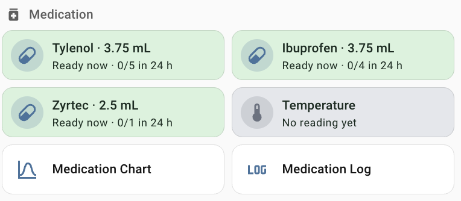
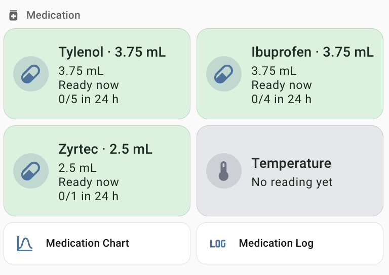
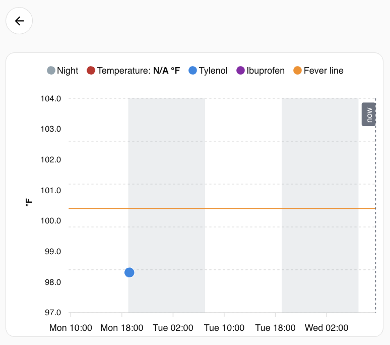
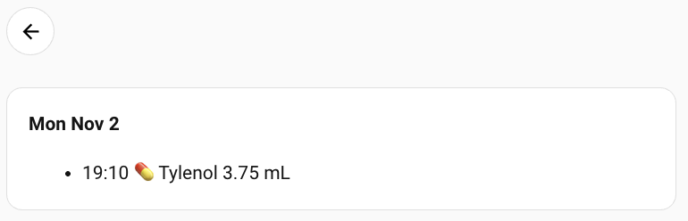

# ha-medication-tracker

> **Not medical advice.** This is a record-keeping and reminder tool. It never decides what to
> give. See [Disclaimer](#disclaimer) before using it.

A small, reliable medication and temperature tracker for a child, built on Home Assistant.
Tap a tile to record a dose, tap another to log a temperature, see a fever chart with the
doses on it, and a 48-hour log you can read to the pediatrician.

Built for the moment at 3 a.m. when two tired parents are asking "when did we last give what?"

## What it does

- **One tap records the configured dose** (from a weight-based chart, or a fixed dose).
  If the configured interval or daily limit says it's too early, it asks *"Too early: only 1h 12m
  since the dose at 14:30. Log Tylenol 3.75 mL anyway?"* — and records it if you say so.
  A dose that was given but not recorded is more dangerous than one recorded early.
- **Icon-tap / hold opens an edit popup** with −/+ buttons: amount and "hours ago". No keyboard,
  works on a wall panel.
- **Temperature tile**: tap for −/+ popup preset to the last reading; hold to backdate.
- **Fever chart** (48 h): temperature line, fever line at 100.4 °F, dose dots at the exact time
  given, shaded nights. Backdated entries land at the real time.
- **Timeline**: a day-grouped list of readings and doses for the last 48 h.
- **Tiles**: green = the configured rules allow another dose, yellow = within an hour,
  red = too early. Nothing more than that.

## Screenshots

| Phone / desktop | Wall panel |
|---|---|
|  |  |

| Fever chart | Timeline |
|---|---|
|  |  |

## Design decisions

- **Record first, warn second.** Every real administration can be recorded — early, over the
  daily limit, backdated up to 7 days. Only nonsense is refused (future time, zero, an amount
  above a per-medication safety cap, a temperature outside 93–108 °F).
- **The process that writes the row reports the result.** The dashboard tap fires one Home
  Assistant event; the AppDaemon app validates, writes SQLite, and then itself shows the toast or
  popup in the browser that tapped. There is no waiting on a result sensor, no clock comparison,
  nothing to time out.
- **Duplicates are impossible by construction.** A unique index on (medication, timestamp) plus
  a `BEGIN IMMEDIATE` transaction. The "Log anyway" button carries the original tap's timestamp,
  so pressing it in two open tabs produces one row and one "Already recorded".
- **The chart reads from attributes, not the recorder.** The app publishes the last 4 days of
  readings and doses as sensor attributes; ApexCharts draws from those, so history survives
  recorder purges and backdated entries sit where they belong.
- **Test and production are a config line.** `db_path` in the app's yaml.

## Requirements

- Home Assistant (tested on 2026.10) with the **AppDaemon** add-on
- HACS frontend: **Browser Mod** (popups/toasts), **card-mod** (tile colours),
  **ApexCharts card** (chart)
- Three Number helpers (see Install)
- Browser Mod **registration** for every device that should receive popups — backend-initiated
  popups only reach registered browsers (Browser Mod integration → Configure → Auto-register,
  reload the device, then turn auto-register off). On wall panels also disable
  *Profile → Automatically close connection*.

## Install

1. **Helpers** — Settings → Devices & services → Helpers → Create helper → Number:

   | Name | Entity (auto) | Min | Max | Step | Unit |
   |---|---|---|---|---|---|
   | Child weight lb | `input_number.child_weight_lb` | 5 | 100 | 0.5 | lb |
   | Medication temp entry | `input_number.medication_temp_entry` | 97 | 105 | 0.1 | °F |
   | Medication dose entry | `input_number.medication_dose_entry` | 0.25 | 15 | 0.25 | mL |
   | Medication hours ago | `input_number.medication_hours_ago` | 0 | 48 | 0.5 | h |

   Display mode "Input field" for all. Set the child's weight.

2. **AppDaemon** — copy `appdaemon/apps/medication_tracker.py` and `medication_tracker.yaml`
   into the add-on's `apps/` folder. Edit the yaml: your medications, charts, caps. Start with
   `db_path` pointing at a scratch file. The log should show
   `Medication tracker using database …`.

3. **Script** — paste `homeassistant/scripts.yaml` into `/config/scripts.yaml`, then
   Developer tools → YAML → Scripts.

4. **Dashboard** — in a sections-view dashboard, add `dashboard/section-phone-desktop.yaml`
   (or `section-wall-panel.yaml` for a small touch panel) as a section, and
   `dashboard/subview-chart.yaml` and `subview-log.yaml` as views. Replace `/YOUR-DASHBOARD/`
   with your dashboard's URL path. To add or remove a medication, add/remove it in the yaml and
   copy a tile block; the sensor is `sensor.medication_<name>`.

5. **Test** on the scratch database (tap, "Log anyway", two tabs, edit popup, temperature,
   120 °F refusal), then switch `db_path` to the real file.

## How it fits together

```
tile tap ──fire-dom-event──▶ script.medication_record ──event──▶ AppDaemon app
                                   (heartbeat check)              │ validate
                                                                  │ SQLite write
                                                                  ▼
                         sensors (tiles, chart, timeline) ◀── publish  ──▶ browser_mod
                                                                       toast / popup
                                                                       (to the browser that tapped)
```

Sensors: `sensor.medication_<med>` (state eligible / approaching / too_soon / unknown),
`sensor.medication_temperature` (last °F), `sensor.medication_timeline` (entries in 48 h; the
chart and log cards hide when it is 0), `sensor.medication_tracker_heartbeat`.

Event `medication_record` sources: `tap`, `confirm`, `open_form`, `form_panel`,
`temp_quick_form`, `temp_open_form`, `temp_panel`, plus `form` / `temp` for callers that pass
`volume_ml` / `temp_f` and `administered_at` directly.

## Tests

The rules (dose charts, intervals, rolling 24 h limit after overrides, duplicates, backdating,
status transitions, temperature levels, timeline) are covered by `tests/test_core.py` and run
without Home Assistant:

```
pip install pytest
pytest tests
```

## Disclaimer

This software is provided for personal record-keeping. It is **not medical advice** and does not
calculate, recommend or verify any medication dose. All dose charts, concentrations, intervals,
daily limits and safety caps in the example configuration are **placeholders shipped as zero**;
you must enter the values from your product's label and your child's pediatrician, and you are
responsible for verifying every number. Colours and countdowns reflect only the rules you
configured. The author accepts no liability for any use of this software. If you are unsure
about a dose, call your pediatrician or poison control.

## Status

Running daily in one household since November 2026. Published as a reference, as-is; no
guarantee of support. Issues and PRs are welcome but may sit for a while.

## License

MIT
